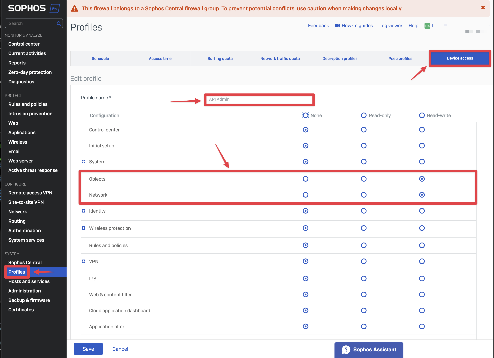
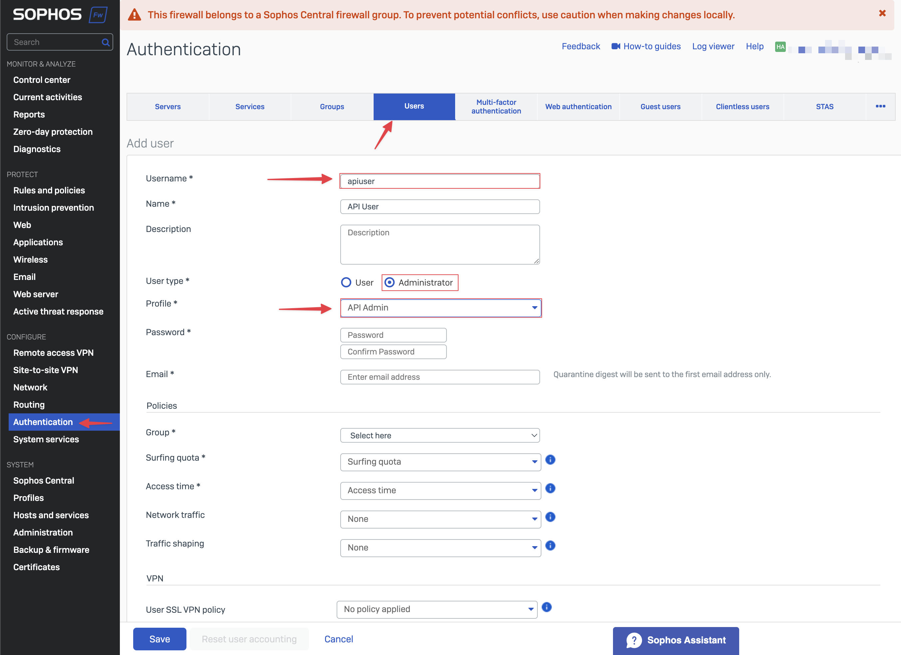
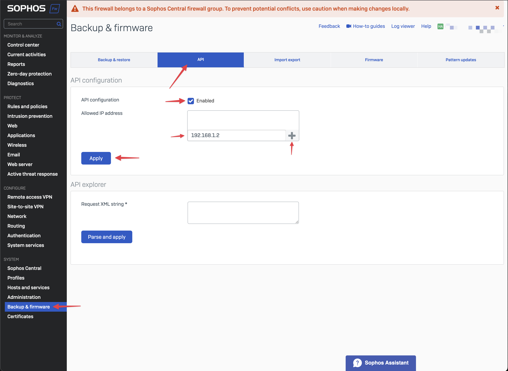

# Sophos-XG-API

Tools for managing Sophos XG Firewalls via API across multiple locations.

## Scripts

| Script | Description |
|--------|-------------|
| `sophos.sh` | Add IP/network host objects from a CSV file (XML API) |
| `blackhole.sh` | Add blackhole routes from a text file across all firewalls (REST API v19+) |

---

## Prerequisites

- [1Password CLI (`op`)](https://developer.1password.com/docs/cli/get-started/) installed and signed in
- API access enabled on each Sophos Firewall
- `curl` available

### Firewall Setup

1. Create a Device Access profile and an API user in Sophos Firewall
   
   

2. Allow API access from your local IP address
   

3. For the REST API (v19+), generate an API key/token under **Backup & Firmware > API**

---

## Configuration

Credentials are stored in 1Password and injected at runtime — nothing sensitive is saved on disk.

### `.env` file

The `.env` file contains 1Password secret references (not actual secrets). Each firewall has its own set of variables:

```bash
# Per-firewall credentials (REST API)
SOPHOS_FREJA_HOST=op://VaultName/FIREWALL_FREJA/hostname
SOPHOS_FREJA_API_KEY=op://VaultName/FIREWALL_FREJA/api_key

SOPHOS_ODENSE_HOST=op://VaultName/FIREWALL_ODENSE/hostname
SOPHOS_ODENSE_API_KEY=op://VaultName/FIREWALL_ODENSE/api_key

# ... repeat for each firewall
```

### 1Password Item Structure

For each firewall, create a 1Password item with these fields:

| Field | Example Value |
|-------|---------------|
| `hostname` | `fw.example.com` or `192.168.1.1` |
| `api_key` | Your REST API token |
| `username` | *(optional, for XML API)* |
| `credential` | *(optional, for XML API)* |

---

## Usage

### Blackhole Routes (`blackhole.sh`)

Adds blackhole (null) routes to all 6 firewalls for every IP/network listed in `blackhole.txt`.

**1. Add addresses to `blackhole.txt`** (one per line):

```text
10.10.10.0/24
192.168.50.5
172.16.0.0/16
```

- Lines starting with `#` are treated as comments
- Inline comments are also supported
- Single IPs are automatically treated as `/32`

**2. Run the script with 1Password:**

```bash
op run --env-file=.env -- ./blackhole.sh
```

To use a different input file:

```bash
op run --env-file=.env -- ./blackhole.sh /path/to/routes.txt
```

**3. Example output:**

```
=== Adding Blackhole Routes ===

Network: 10.10.10.0/24
  [OK] FREJA - 10.10.10.0/24
  [OK] ODENSE - 10.10.10.0/24
  [OK] FIREWALLIN - 10.10.10.0/24
  [OK] FIREWALLTH - 10.10.10.0/24
  [OK] FIREWALLUK - 10.10.10.0/24
  [OK] UNWIND1 - 10.10.10.0/24

=== Done ===
```

### Host Objects (`sophos.sh`)

Adds IP host objects from `ip.csv` to a host group on a single firewall (XML API).

```bash
op run --env-file=.env -- ./sophos.sh
```

---

## How 1Password Integration Works

The `op run` command:

1. Reads the `.env` file
2. Resolves all `op://` references by fetching secrets from your 1Password vault
3. Injects them as environment variables into the script process
4. Secrets never touch disk — they exist only in memory for the duration of the script

If you're not signed in, `op run` will prompt for authentication (biometrics/password).

---

## Security Notes

- `.env` is listed in `.gitignore` — it will never be committed
- No secrets are hardcoded in any script
- API keys exist only in memory during script execution
- All API calls use HTTPS (self-signed certs accepted with `-k`)
